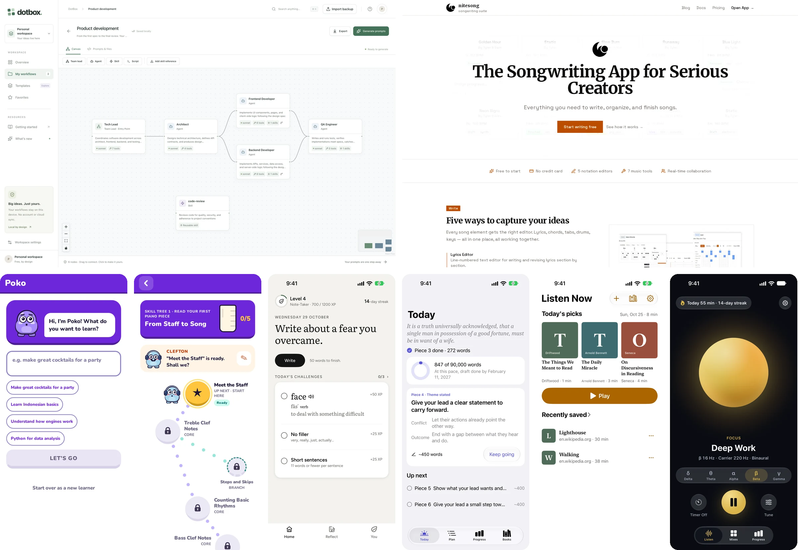

<table>
<tr><td>

### 👋 Hey, I'm Tyler. I build business backbones.

Integration and AI platform engineer in Bloomington, Indiana. By day I connect ERP, CRM and e-commerce systems and ship production AI agents with MCP tooling. After hours I build apps.

</td></tr>
<tr><td>

</td></tr>
<tr><td>

**things i've built** 
<a href="https://dotbox.zip/"><b>DotBox</b></a> · design AI agent teams on a canvas, then generate their setup prompts 
<a href="https://nitesong.io/"><b>nitesong</b></a> · a songwriting suite, built and run end to end 
<a href="https://github.com/tylercyert/poko"><b>Poko</b></a> · adaptive learning app, Wildcard Segment winner at Indy Init 2026 
 <a href="https://apps.tyl.sh/small-pages/"><b>Small Pages</b></a> ·  <a href="https://apps.tyl.sh/chapterwise/"><b>Chapterwise</b></a> ·  <a href="https://apps.tyl.sh/driftwood/"><b>Driftwood</b></a> ·  <a href="https://apps.tyl.sh/focustones/"><b>FocusTones</b></a> · quiet iPhone apps from <a href="https://apps.tyl.sh/">Tyl Softworks</a>

</td></tr>
<tr><td>

**agents / ai** 

</td></tr>
<tr><td>

**integration** 

</td></tr>
<tr><td>

**languages** 

</td></tr>
<tr><td>

**web / infra** 

</td></tr>
</table>
